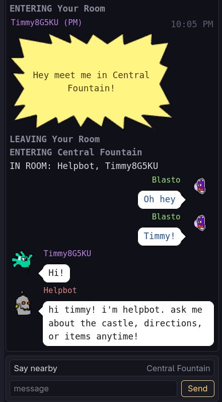

# C8 Chat

[](https://github.com/DionJones615/C8chat/actions/workflows/ci.yml)
[](https://github.com/DionJones615/C8chat/actions/workflows/release.yml)
[](LICENSE)

An unofficial browser panel for [Castle Infinity](https://www.castleinfinity.com/)
chat. It shows the room transcript, the game's character heads, who is in the
room, and private messages. The panel can float, dock left, or dock right.

C8 Chat is a Manifest V3 extension with no runtime dependencies and no developer
server. It runs only on `https://www.castleinfinity.com/*`. The extension code is
plain JavaScript, CSS, and JSON; packaging validates the manifest, stages the
Firefox and Chromium manifest shapes, and writes the archives.

C8 Chat is not affiliated with Castle Infinity, its preservation project, or any
rights holder.

<p align="center">
  
</p>

## Features

- **Transcript** — timestamps, per-speaker colours, character heads read from
  the running game, and a 300-line local scrollback.
- **Room presence** — the roster on arrival, plus joins, leaves, room changes,
  disconnects, and reconnects from the game's own traffic.
- **TEAM-room guard** — in a room whose only entrance is a TEAM entrance (Hall of
  Peril, the Super Duper Seaquest rooms, and the other confirmed TEAM rooms), the
  chat is replaced by a dismissible notice; **That's OK** reveals it for that visit.
- **Private messages** — choose a player from the recipient list, send a private
  message, and see the `(PM)` marker; players in your sector are marked `(here)`.
- **Docking** — float, dock left, or dock right; placement, dock width, and
  floating size and position persist.
- **Themes and settings** — Default (large heads with a CSS-drawn speech
  balloon), Classic, Paper (light), and Terminal (amber); text and head sizes,
  timestamp format, and visibility switches.
- **Debug capture** — capture raw frames in memory and export them for protocol
  work.

C8 Chat does not add game features such as inventory, stash, postcards, or
macros. It reads the game's chat, presence, and player-list traffic; messages you
send use the game's own connection.

## Install

C8 Chat is distributed through GitHub Releases. Download the asset for your
browser family from the [latest release](https://github.com/DionJones615/C8chat/releases/latest).
Chromium 121+ and Firefox 142+ are required.

| Browser family | Download | Install |
| --- | --- | --- |
| **Chromium-based** (Chrome, Chromium, Edge, Brave, …) | [`c8-chat-chrome.zip`](https://github.com/DionJones615/C8chat/releases/latest/download/c8-chat-chrome.zip) | Extract it, open the browser’s extensions page (for example `chrome://extensions`), enable **Developer mode**, and **Load unpacked** the folder containing `manifest.json`. |
| **Firefox-based** (Firefox, LibreWolf, Waterfox, …) | [`c8-chat-firefox-signed.xpi`](https://github.com/DionJones615/C8chat/releases/latest/download/c8-chat-firefox-signed.xpi) | Open `about:addons`, click the gear button, and choose **Install Add-on From File**. |
| **All assets** | [`releases/latest`](https://github.com/DionJones615/C8chat/releases/latest) | Chromium ZIP, Firefox signed/unsigned XPI, source ZIP, and `SHA256SUMS`. |

Chromium-based browsers do not auto-update unpacked extensions: replace the
folder contents with the new release and click **Reload**. Chrome 137 removed
the `--load-extension` command-line flag from Chrome-branded builds; the
extensions-page UI is the supported path.

Firefox-based browsers install the **signed** XPI. Firefox checks the extension’s
`update_url` for updates. The unsigned XPI is for development, or for forks
that explicitly allow unsigned add-ons; stock Firefox requires the signed build.
GitHub may serve the XPI as a download rather than an install prompt — save it,
then use **Install Add-on From File**.

Detailed steps and checksum verification are in [docs/INSTALL.md](docs/INSTALL.md).

### Development builds

After `npm ci`, run `npm run package:unpacked`, then choose **Load unpacked**
and select `dist/chromium-unpacked` for Chromium development. For Firefox development, open
`about:debugging#/runtime/this-firefox`, choose **Load Temporary Add-on…**, and
select `manifest.json`.

## Privacy

C8 Chat stores the chat scrollback, settings, recent recipients, the last room,
and small diagnostic samples in the extension’s local storage
(`chrome.storage.local`). It does not send those local records to the developer
or to any additional service. Messages you send go through the game’s own
WebSocket, the same connection the game uses. There are no analytics, ads, or
remote code. Private browsing is disabled for the extension. The toolbar button
uses the tabs API only to find an existing Castle Infinity tab to focus, or to
open one; it does not read page content from other sites.

The full policy is [PRIVACY.md](PRIVACY.md) and is published at
<https://dionjones615.github.io/C8chat-privacy/>.

## How it works

The game is an Emscripten/WASM client, and its traffic passes through a browser
`WebSocket`. The extension has two content scripts and a background toolbar
handler:

| Piece | Scope | Role |
| --- | --- | --- |
| `src/protocol.js` | MAIN | Wire codec and message decoders |
| `src/agent.js` | MAIN | Taps the page's WebSocket and input hooks |
| `src/panel.js` | ISOLATED | Chat UI, settings, storage, and feature logic |
| `src/background.js` | Background | Focuses an open game tab or opens one from the toolbar |

The two content-script worlds communicate only through `window.postMessage`, and
the agent redacts the account key from text it forwards or stores. When
docked, the panel reserves space by adjusting the game's `#stage`; the page's own
layout code re-fits the canvas, and the canvas itself is not modified.

The detailed protocol map, feature notes, and protocol limitations are in
[docs/protocol.md](docs/protocol.md). Test-harness details are in
[docs/testing.md](docs/testing.md).

## Development

Requirements: Node.js 22+ and npm.

```sh
npm ci
npm run check
```

- `npm test` — Node test suite (`test/*.test.mjs`).
- `npm run lint` — packages `dist/unpacked`, then runs `web-ext lint`.
- `npm run package` — builds the Chromium ZIP, Firefox unsigned XPI, source ZIP,
  stable aliases, and `SHA256SUMS` in `dist/`.
- `npm run smoke` — headless Chromium smoke test (requires Chromium; see
  [AGENTS.md](AGENTS.md)).

There is no source build or transpiler. `scripts/package.mjs` validates the
manifest, stages the Firefox (`background.scripts`) and Chromium
(`background.service_worker`) manifest shapes, and writes the archives; it does
not transform `src/`. See [README-BUILD.md](README-BUILD.md) for the
reviewer-facing reproduction instructions.

## Releasing

1. Bump the version in `manifest.json` and `package.json`, and update
   [CHANGELOG.md](CHANGELOG.md).
2. Update [docs/updates.json](docs/updates.json) with
   `node scripts/updates.mjs`, then run `npm ci && npm run check`.
3. Commit, tag `v<version>`, and push the tag. The release workflow verifies the
   version and creates a GitHub Release with the Chromium ZIP, Firefox unsigned
   XPI, source ZIP, stable aliases, and checksums.
4. Run the manual **Sign Firefox (AMO unlisted)** workflow to sign the Firefox
   package and upload the signed XPI. See [DISTRIBUTING.md](DISTRIBUTING.md).

## Contributing

See [CONTRIBUTING.md](CONTRIBUTING.md) and
[CODE_OF_CONDUCT.md](CODE_OF_CONDUCT.md). Security reports should follow
[SECURITY.md](SECURITY.md), not a public issue.

## License

The extension code is [MIT licensed](LICENSE). Castle Infinity and its artwork
belong to their respective rights holders. The speech balloons are drawn in CSS
rather than shipped, and character head art is read from the running game at
runtime. The only Castle Infinity artwork embedded in the extension is the small
radio starburst used to mark private messages; remove that rule in
`src/panel.css` if you need a build without it.

## Contact

dion.jones@gmail.com
